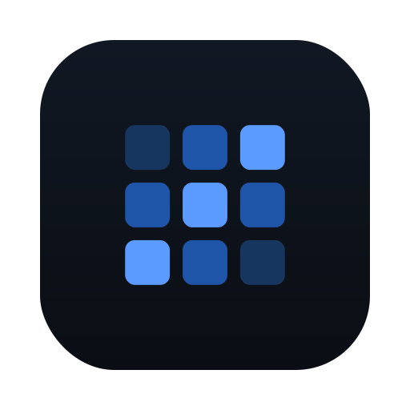
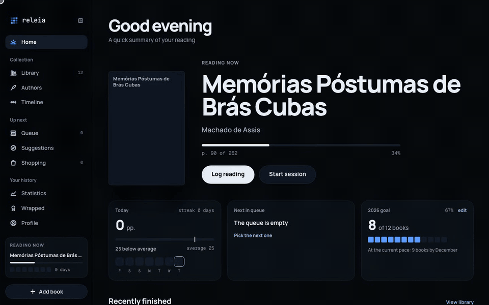
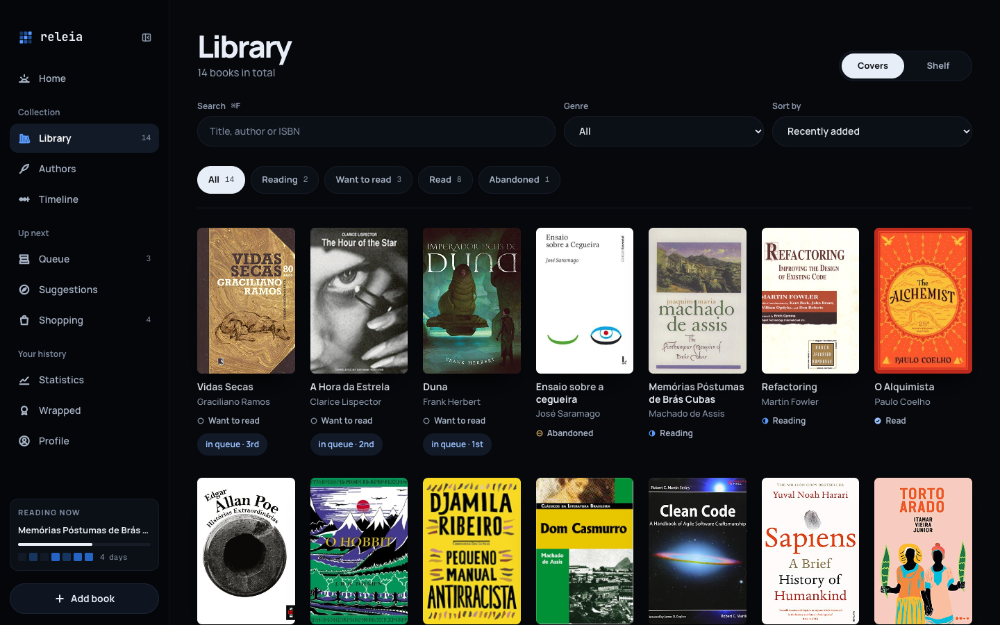
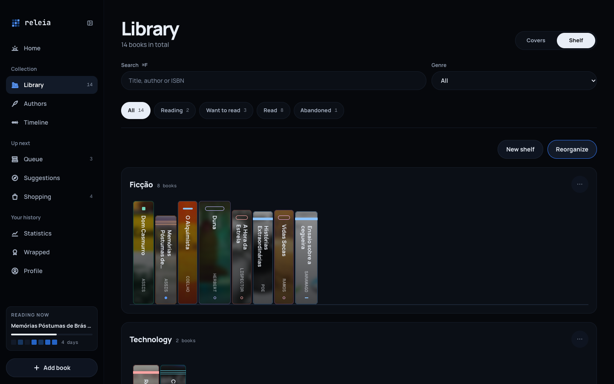
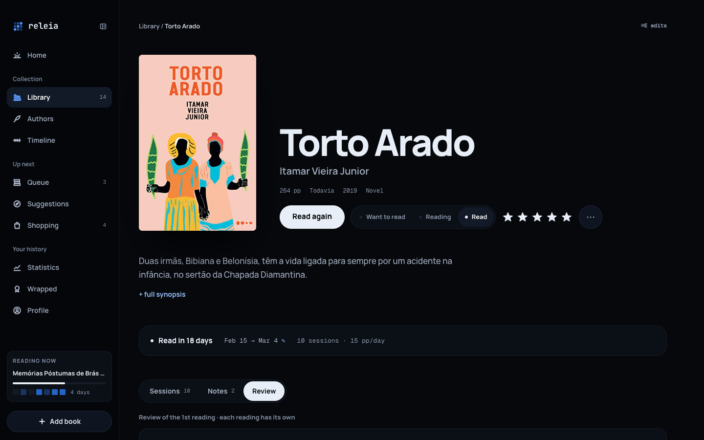
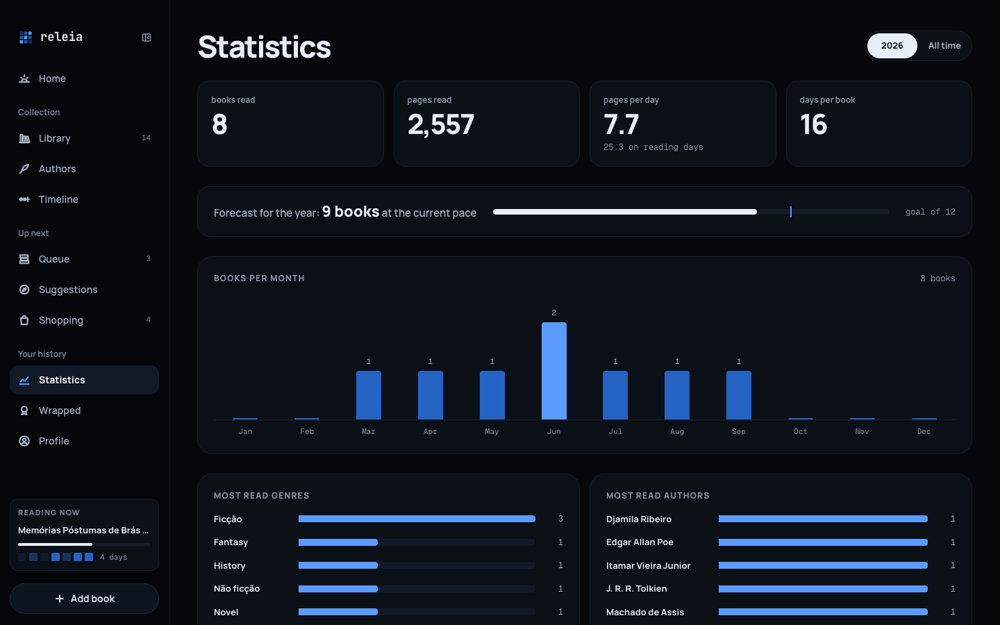
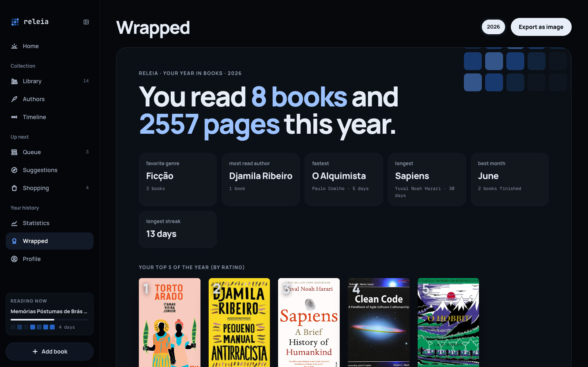
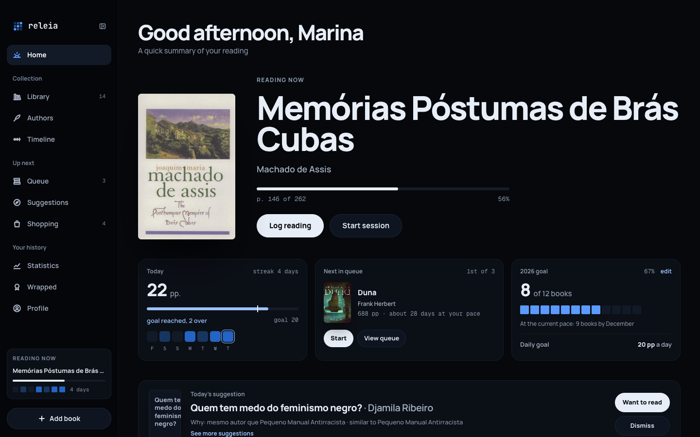
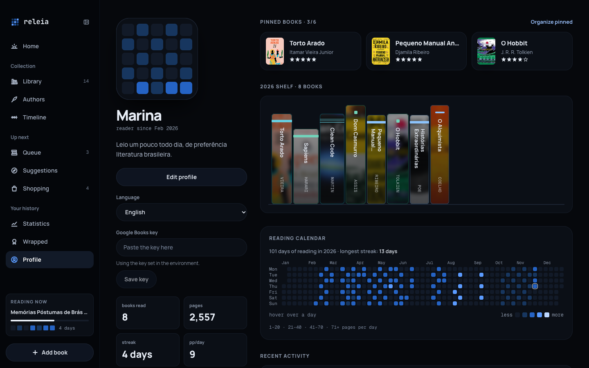

<p align="center">
  
</p>

<h1 align="center">releia</h1>

<p align="center">
  A personal macOS app to catalog the physical books you read and turn your reading into stats, notes and suggestions.
</p>

<p align="center">
  <a href="https://github.com/enzobreisc/releia/actions/workflows/tests.yml"></a>
  
  
  
  
</p>

<p align="center">
  English · <a href="README.pt-BR.md">Português</a> · <a href="https://enzobreisc.github.io/releia/">Live demo</a>
</p>



## Live demo

**[Try the web demo](https://enzobreisc.github.io/releia/)**: the same interface running in your browser against a sample library, with nothing to install. It also has a phone layout for narrow screens.

- The main flows work: library and shelves, adding books, reading sessions, notes, stats, timeline, queue, shopping list and suggestions. The sample suggestions come ready-made.
- Your library stays in your browser's local storage and is never sent to a server; "Restore data" brings the sample library back. Book searches still go from the browser to Open Library and BrasilAPI.
- Some things only work in the app: the menu bar window, the phone quick log over Tailscale, Google Books lookups and price lookups.
- How it works: the demo reuses the React pages from `resources/js`. The Laravel presenters are ported to TypeScript (`demo/src/presenters`) and checked against golden pages exported from the PHP app, and the user flows (add, read, shop, undo) are replayed from scenarios recorded from the app. Details in [demo/README.md](demo/README.md).

## Features

- **Add books in seconds** by ISBN or title: metadata and covers come from Open Library, Google Books and BrasilAPI, and are cached locally. A cover can also be taken from an Amazon product link.
- **Log reading sessions** from the main window or from a menu bar window opened by a global shortcut (`⌘⇧L` by default), without leaving what you are doing.
- **Log from your phone**: the same quick log installs on the home screen as a web app and talks to the Mac over [Tailscale](https://tailscale.com), sharing its database, with a lock screen widget that counts the current session ([setup](docs/mobile-quick-log.md)).
- **Library** as a cover grid or a bookcase of named shelves: a step-by-step setup splits the books by publisher, author, genre or series (several groups can share a shelf) and shows a preview to approve. Spines are drawn from the real edition's cover with a look per publisher, new books join the shelf of their group, and shelves and books can still be rearranged by hand.
- **Book page** with every reading, its sessions, Markdown notes and a review per reading; rereads are tracked separately.
- **Statistics**: books and pages per month, pace, yearly goal forecast, top genres and authors, and a reading calendar heat map.
- **Wrapped**: a yearly summary that can be exported as an image.
- **Queue, shopping list and suggestions**: plan what to read next, track the lowest price of a wanted edition on Estante Virtual, and get suggestions, each with its reason, from the books you rated highly, the ones you want to read and your shopping list, or write a request in your own words, such as "more Dostoevsky, but short".
- **Authors and timeline**: per-author reading stats with photos from Open Library or Wikipedia, and a timeline of readings by year.
- **Bilingual interface** in Portuguese and English, including dates, numbers and money.
- **Offline first**: everything lives in a local SQLite database and covers are downloaded to disk, so the app keeps working without a connection.

## Screenshots

| Library                                  | Bookcase                                   |
| ---------------------------------------- | ------------------------------------------ |
|  |  |
|        |   |
|  |          |
|  |                                            |

<sub>Screenshots use the sample library of the web demo (`demo/export/seed.php`).</sub>

## Technical highlights

- **A Laravel app shipped as a native desktop app.** [NativePHP](https://nativephp.com) bundles PHP and the app into Electron, so the same codebase renders an Inertia + React UI, owns the window, the menu bar icon and the global shortcut ([`app/Native/QuickLog.php`](app/Native/QuickLog.php)).
- **One screen, two shells.** The quick log page runs both in the menu bar window and as an installable PWA on the phone: a `launchd` agent serves it over the tailnet against the desktop app's SQLite file and storage, and the page switches to touch-sized controls when it is not inside the native app.
- **Metadata lookup behind a single contract.** Each source implements [`MetadataProvider`](app/Services/BookLookup/MetadataProvider.php). [`BookLookupService`](app/Services/BookLookupService.php) asks Open Library first and lets BrasilAPI and Google Books fill gaps or act as fallbacks, caching the results, so a new source is one class. Editions from the publishers already in your library are listed and suggested first.
- **Explainable suggestions.** [`RecommendationService`](app/Services/RecommendationService.php) starts from your highly rated books and from what you want to read or buy, looks for other works by the same authors, reading further Open Library pages until it has twenty new ones, keeps at most three works by the same author unless you asked for that author, brings back at most one ignored suggestion per search, and ranks candidates by score ([`ScoredRanker`](app/Services/Recommendation/ScoredRanker.php)). Every suggestion carries the reason it was made, and searches are time-boxed and cached.
- **Thin controllers, rich services.** Business rules live in services, and presenters shape the props each Inertia page receives.
- **Thin pages, small components.** Each React page only composes components that live in a folder named after it; state sits in `use-*` hooks and pure helpers in `lib/`, so no page is a thousand-line file.
- **i18n where the key is the source text.** Strings are written in Portuguese and translated in [`lang/en.json`](lang/en.json); the type check fails on a missing React key and a feature test fails on a missing PHP key.
- **Quality gates in CI.** Pint, PHPStan, Pest feature tests, Vite+ lint and format, and `tsc` run on every push to `main` and on every pull request. The web demo is built and deployed to GitHub Pages on each push to `main`.

## Stack

| Layer     | Choice                                   |
| --------- | ---------------------------------------- |
| Backend   | Laravel 13, PHP 8.4                      |
| Desktop   | NativePHP Desktop 2 (Electron)           |
| Mobile    | PWA served over Tailscale                |
| Database  | SQLite                                   |
| Front end | Inertia 3, React 19, TypeScript          |
| Styling   | Tailwind CSS 4                           |
| Quality   | Pest, PHPStan, Pint, Vite+ lint/fmt, tsc |

## Install

Download the latest `.dmg` from [Releases](https://github.com/enzobreisc/releia/releases/latest) (Apple Silicon) and drag **releia** to Applications.

The app is not notarized by Apple, so macOS blocks the first launch. Open **System Settings → Privacy & Security** and click **Open Anyway**. If macOS reports that the app is damaged, remove the quarantine flag:

```bash
xattr -dr com.apple.quarantine /Applications/releia.app
```

To log sessions from your phone, follow [docs/mobile-quick-log.md](docs/mobile-quick-log.md).

## Google Books key (optional)

Without a key, Google Books shares a daily quota among everyone and often refuses requests; Open Library and BrasilAPI keep working. To use your own quota, create a [Books API key](https://developers.google.com/books/docs/v1/using#APIKey) and paste it on the Profile page. It is stored encrypted in the local database and is never part of the published app. In development, `GOOGLE_BOOKS_API_KEY` in `.env` also works.

## Local model for requests (optional)

To write a request such as "more Dostoevsky, but short", run [Ollama](https://ollama.com) on your Mac with the `qwen3:4b` model: `ollama pull qwen3:4b`, once. The model only turns the sentence into authors, authors to avoid and a page limit; the books still come from Open Library. Without it, the pending suggestions keep working and the request field says what is missing.

## Development

Requirements: PHP 8.4, Composer, Node 22+.

```bash
composer setup        # install dependencies, generate APP_KEY, migrate and build
composer native:dev   # run the app in a native window (needs an interactive terminal)
composer dev          # or run only the web server at http://localhost:8000
```

To explore the app with data, seed the demo library:

```bash
php artisan db:seed --class=DemoSeeder
```

In development (`APP_DEBUG=true`) the native app uses `database/nativephp.sqlite`, separate from the `database/database.sqlite` used by `composer dev`. It is created and migrated on first launch; after adding migrations, run `php artisan native:migrate`.

| Command                                   | What it runs                                                                  |
| ----------------------------------------- | ----------------------------------------------------------------------------- |
| `composer test`                           | Pint, PHPStan and Pest                                                        |
| `npm run check`                           | front-end lint and formatting                                                 |
| `npm run types:check`                     | TypeScript type check                                                         |
| `php artisan native:build mac`            | builds the `.app`, `.dmg` and `.zip`                                          |
| `npm run demo:test`                       | web demo tests against the golden pages (run `bash demo/export/run.sh` first) |
| `npm run demo:build`                      | builds the web demo into `dist-demo/`                                         |
| `php artisan releia:suggestions`          | searches new suggestions                                                      |
| `php artisan releia:lookup "…"`           | searches book metadata without saving it                                      |
| `php artisan releia:fill-shopping-prices` | looks up prices for the shopping list                                         |

## Project structure

```
app/
  Enums/                ReadingStatus, BookSource, Locale…
  Http/Controllers/     one thin controller per screen
  Http/Presenters/      shape the props sent to each Inertia page
  Models/               Book, Reading, ReadingSession, Note…
  Native/               menu bar window and global shortcut
  Services/             domain logic: lookup, readings, stats, suggestions…
    Ai/                 turns a written request into filters with a local model
    BookLookup/         metadata providers (Open Library, Google Books, BrasilAPI)
    PriceLookup/        shopping list prices (Estante Virtual)
    Recommendation/     suggestion search and ranking
  Console/Commands/     releia:suggestions, releia:lookup…
resources/js/
  pages/                one Inertia page per screen, kept thin
  components/           shared UI, plus one folder per page (book/, stats/…)
  hooks/                state and side effects extracted from components
  lib/                  pure helpers: formatting, dates, routes, i18n
lang/en.json            English translations
demo/                   web demo: sample data, golden pages, browser shell
tests/Feature/          behavior tests per feature
```

## License

[MIT](LICENSE)
