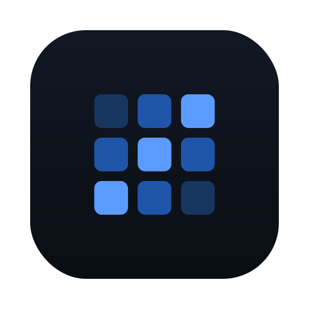
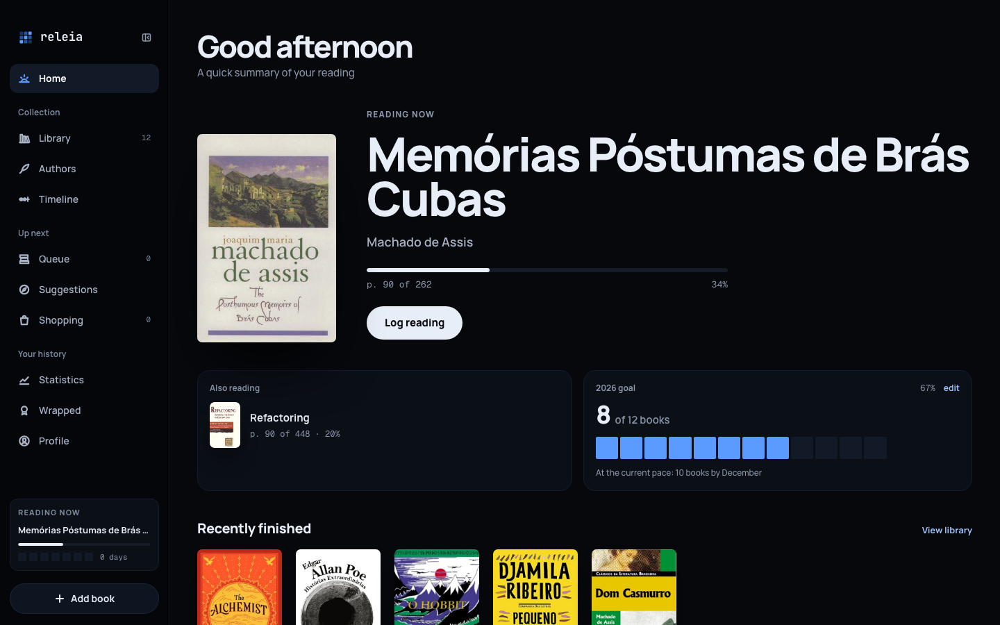
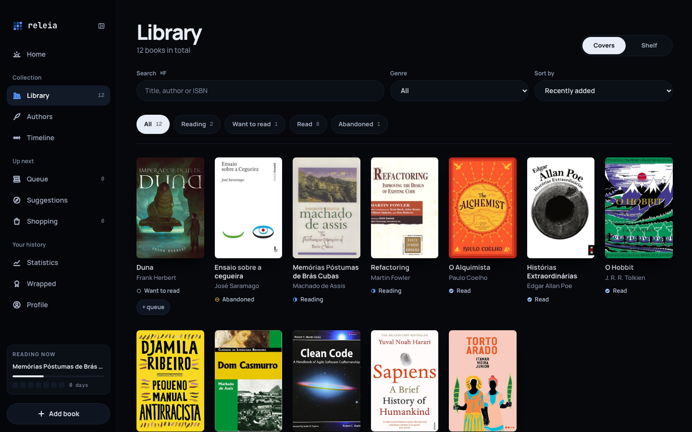
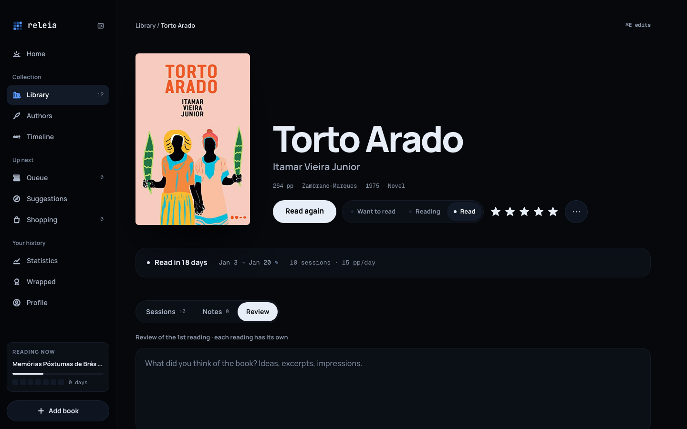
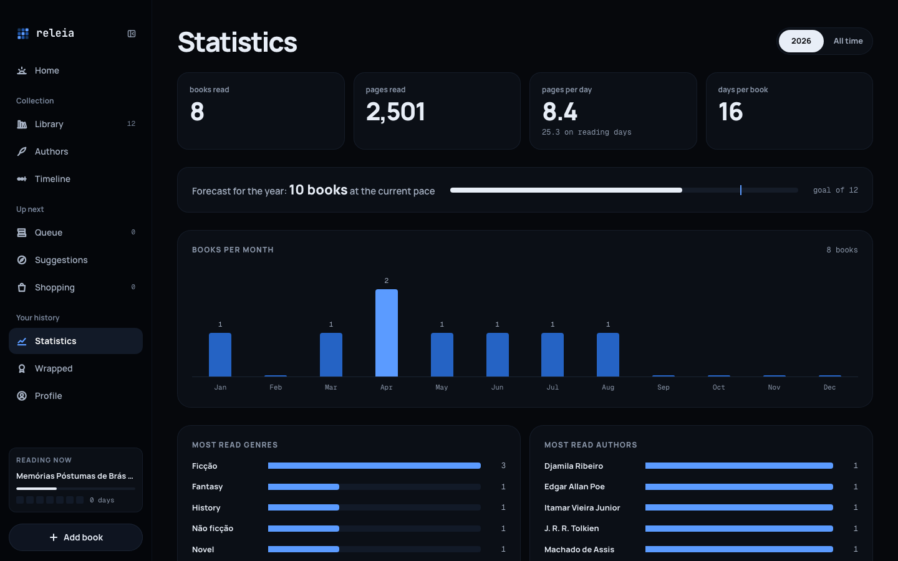
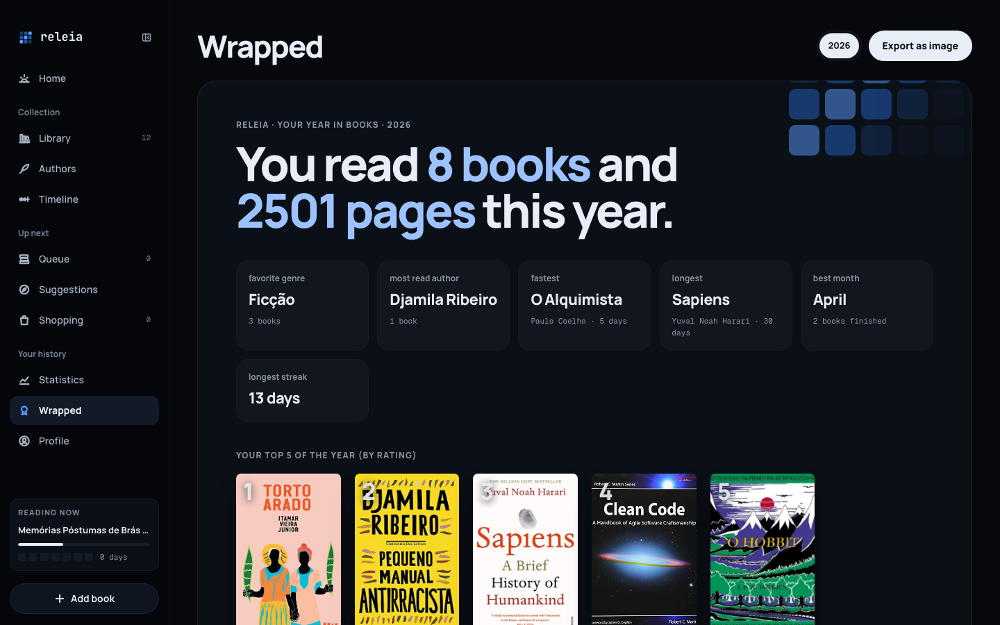
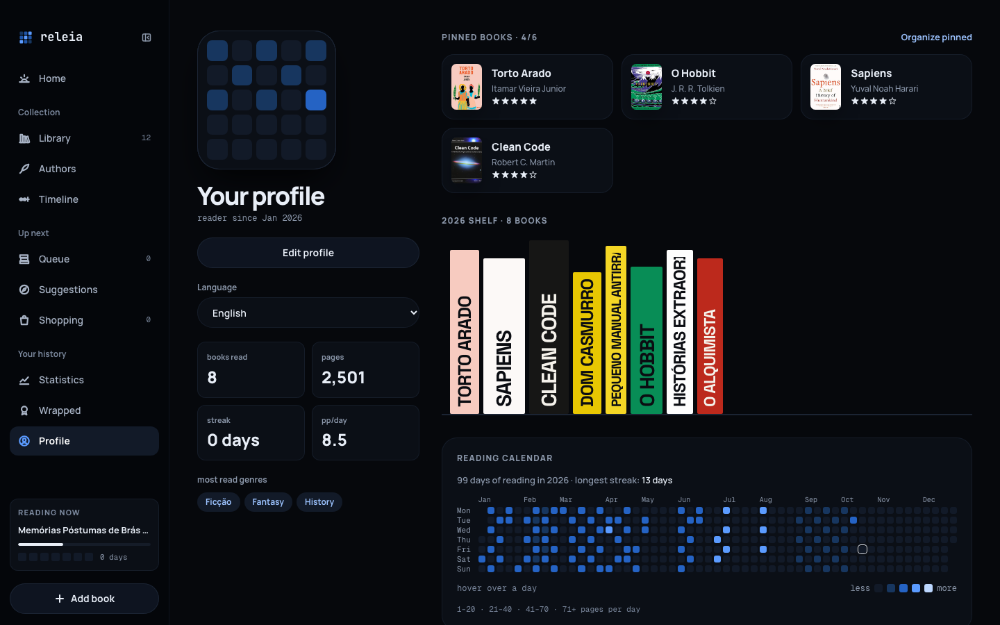

<p align="center">
  
</p>

<h1 align="center">releia</h1>

<p align="center">
  A personal macOS app to catalog the physical books you read and turn your reading into stats, notes and suggestions.
</p>

<p align="center">
  <a href="https://github.com/enzobreisc/releia/actions/workflows/tests.yml"></a>
  
  
  
  
</p>

<p align="center">
  English · <a href="README.pt-BR.md">Português</a>
</p>



## Features

- **Add books in seconds** by ISBN or title: metadata and covers come from Open Library, Google Books and BrasilAPI, and are cached locally.
- **Log reading sessions** from the main window or from a menu bar window opened by a global shortcut (`⌘⇧L`), without leaving what you are doing.
- **Log from your phone**: the same quick log installs on the home screen as a web app and talks to the Mac over [Tailscale](https://tailscale.com), sharing its database ([setup](docs/mobile-quick-log.md)).
- **Library** as a cover grid or a typographic bookshelf, with search, filters by status and genre, and sorting.
- **Book page** with every reading, its sessions, Markdown notes and a review per reading; rereads are tracked separately.
- **Statistics**: books and pages per month, pace, yearly goal forecast, top genres and authors, and a reading calendar heat map.
- **Wrapped**: a yearly summary that can be exported as an image.
- **Queue, shopping list and suggestions**: plan what to read next, track the lowest price of a wanted edition, and get suggestions explained by the books you rated highly.
- **Authors and timeline**: per-author reading stats with photos from Open Library or Wikipedia, and a timeline of readings by year.
- **Bilingual interface** in Portuguese and English, including dates, numbers and money.
- **Offline first**: everything lives in a local SQLite database and covers are downloaded to disk, so the app keeps working without a connection.

## Screenshots

| Library                                  | Book                               |
| ---------------------------------------- | ---------------------------------- |
|  |  |

| Statistics                                | Wrapped                                  |
| ----------------------------------------- | ---------------------------------------- |
|  |  |

| Profile                                  |
| ---------------------------------------- |
|  |

<sub>Screenshots use the bundled demo library (`php artisan db:seed --class=DemoSeeder`).</sub>

## Technical highlights

- **A Laravel app shipped as a native desktop app.** [NativePHP](https://nativephp.com) bundles PHP and the app into Electron, so the same codebase renders an Inertia + React UI, owns the window, the menu bar icon and the global shortcut ([`app/Native/QuickLog.php`](app/Native/QuickLog.php)).
- **One screen, two shells.** The quick log page runs both in the menu bar window and as an installable PWA on the phone: a `launchd` agent serves it over the tailnet against the desktop app's SQLite file and storage, and the page switches to touch-sized controls when it is not inside the native app.
- **Metadata lookup behind a single contract.** Each source implements [`MetadataProvider`](app/Services/BookLookup/MetadataProvider.php). [`BookLookupService`](app/Services/BookLookupService.php) asks Open Library first and lets BrasilAPI and Google Books fill gaps or act as fallbacks, caching the results, so a new source is one class.
- **Explainable suggestions.** [`RecommendationService`](app/Services/RecommendationService.php) starts from your highly rated books, looks for other works by the same authors and subjects, and ranks candidates through a pluggable [`CandidateRanker`](app/Services/Recommendation/CandidateRanker.php). Every suggestion carries the reason it was made, and searches are time-boxed and cached.
- **Thin controllers, rich services.** Business rules live in services, and presenters shape the props each Inertia page receives.
- **i18n where the key is the source text.** Strings are written in Portuguese and translated in [`lang/en.json`](lang/en.json); the type check fails on a missing React key and a feature test fails on a missing PHP key.
- **Quality gates in CI.** Pest feature tests, PHPStan, Pint, Vite+ lint and format, and `tsc` run on every push.

## Stack

| Layer     | Choice                                   |
| --------- | ---------------------------------------- |
| Backend   | Laravel 13, PHP 8.4                      |
| Desktop   | NativePHP Desktop 2 (Electron)           |
| Mobile    | PWA served over Tailscale                |
| Database  | SQLite                                   |
| Front end | Inertia 3, React 19, TypeScript          |
| Styling   | Tailwind CSS 4                           |
| Quality   | Pest, PHPStan, Pint, Vite+ lint/fmt, tsc |

## Install

Download the latest `.dmg` from [Releases](https://github.com/enzobreisc/releia/releases/latest) (Apple Silicon) and drag **releia** to Applications.

The app is not notarized by Apple, so macOS blocks the first launch. Open **System Settings → Privacy & Security** and click **Open Anyway**. If macOS reports that the app is damaged, remove the quarantine flag:

```bash
xattr -dr com.apple.quarantine /Applications/releia.app
```

To log sessions from your phone, follow [docs/mobile-quick-log.md](docs/mobile-quick-log.md).

## Development

Requirements: PHP 8.4, Composer, Node 22+.

```bash
composer setup        # install dependencies, generate APP_KEY, migrate and build
composer native:dev   # run the app in a native window (needs an interactive terminal)
composer dev          # or run only the web server at http://localhost:8000
```

To explore the app with data, seed the demo library:

```bash
php artisan db:seed --class=DemoSeeder
```

In development (`APP_DEBUG=true`) the native app uses `database/nativephp.sqlite`, separate from the `database/database.sqlite` used by `composer dev`. It is created and migrated on first launch; after adding migrations, run `php artisan native:migrate`.

| Command                        | What it runs                         |
| ------------------------------ | ------------------------------------ |
| `composer test`                | Pint, PHPStan and Pest               |
| `npm run check`                | front-end lint and formatting        |
| `npm run types:check`          | TypeScript type check                |
| `php artisan native:build mac` | builds the `.app`, `.dmg` and `.zip` |

## Project structure

```
app/
  Enums/                ReadingStatus, BookSource, Locale…
  Http/Controllers/     one thin controller per screen
  Http/Presenters/      shape the props sent to each Inertia page
  Models/               Book, Reading, ReadingSession, Note…
  Native/               menu bar window and global shortcut
  Services/             domain logic: lookup, readings, stats, suggestions…
    BookLookup/         metadata providers (Open Library, Google Books, BrasilAPI)
    Recommendation/     suggestion ranking
resources/js/
  pages/                one Inertia page per screen
  components/           shared UI
  hooks/                extracted component logic
lang/en.json            English translations
tests/Feature/          behavior tests per feature
```

## License

[MIT](LICENSE)
