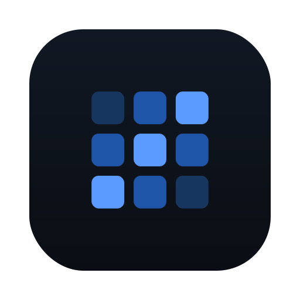
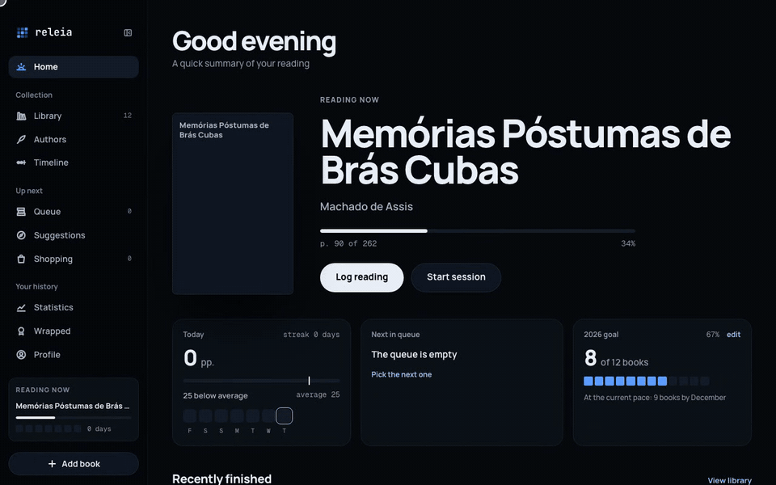
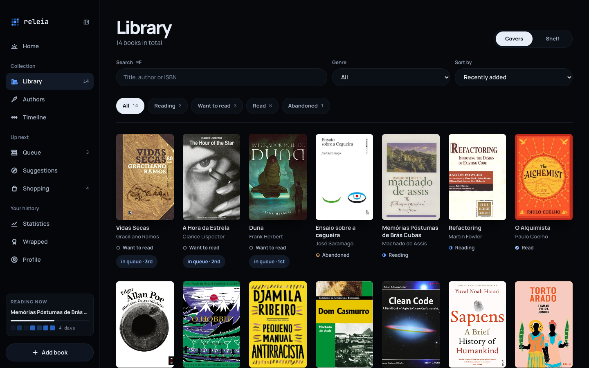
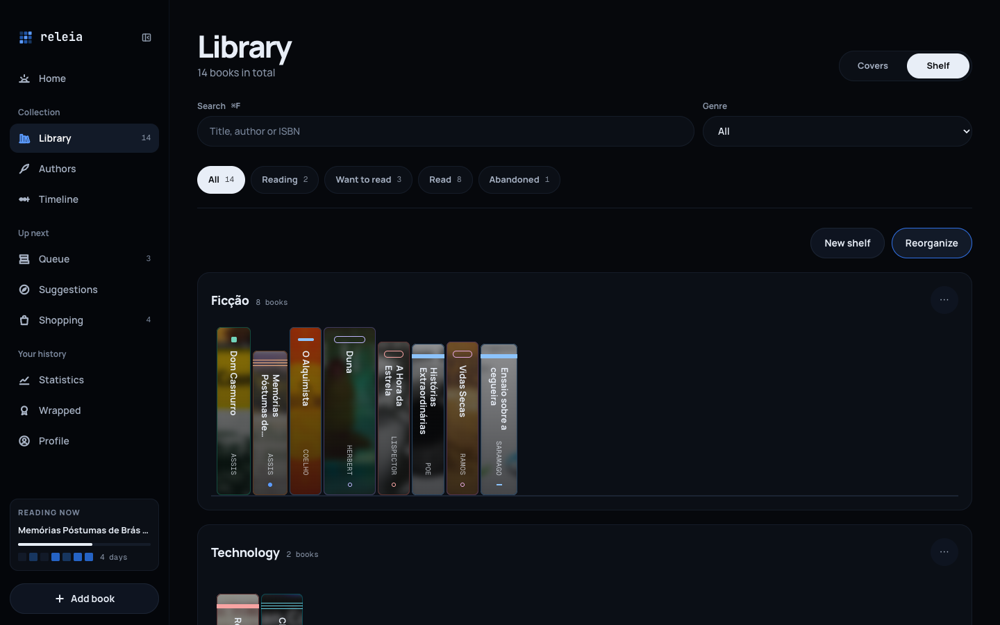
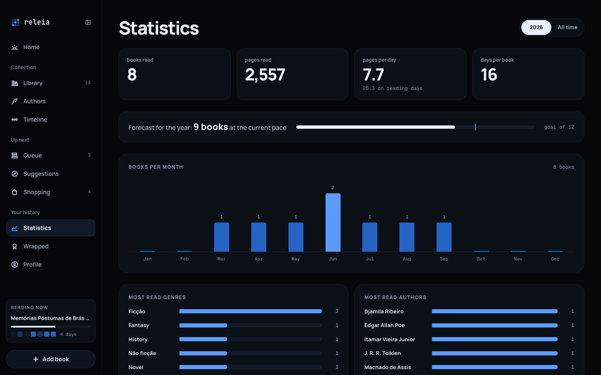
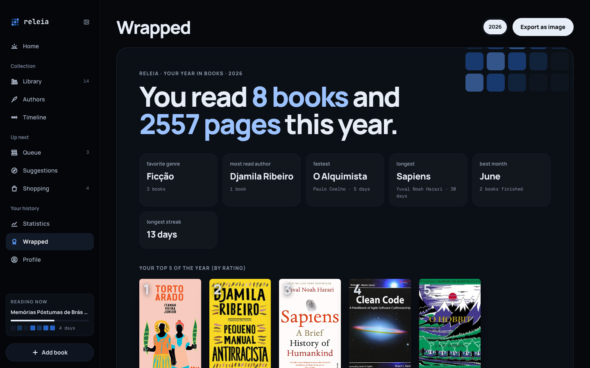
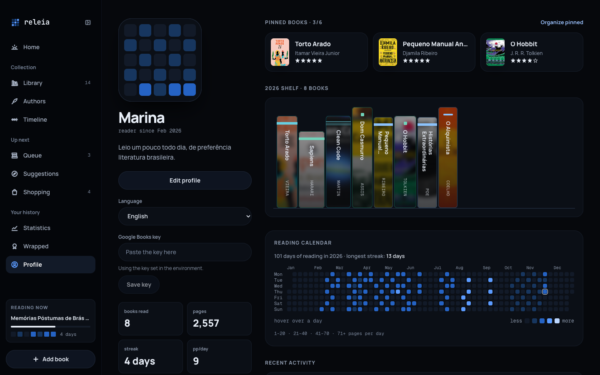

<p align="center">
  
</p>

<h1 align="center">releia</h1>

<p align="center">
  App pessoal para Mac que cataloga os livros físicos que você lê e transforma a leitura em estatísticas, notas e sugestões.
</p>

<p align="center">
  <a href="https://github.com/enzobreisc/releia/actions/workflows/tests.yml"></a>
  
  
  
  
</p>

<p align="center">
  <a href="README.md">English</a> · Português · <a href="https://enzobreisc.github.io/releia/">Demonstração online</a>
</p>



## Demonstração online

**[Abrir a demonstração web](https://enzobreisc.github.io/releia/)**: a mesma interface rodando no navegador, com uma biblioteca de exemplo e sem nada para instalar. Também tem layout de celular para telas estreitas.

- Os fluxos principais funcionam: biblioteca e estantes, adicionar livros, sessões de leitura, anotações, estatísticas, linha do tempo, fila, lista de compras e sugestões. As sugestões de exemplo já vêm prontas.
- Sua biblioteca fica no armazenamento local deste navegador e nunca é enviada a um servidor; "Restaurar dados" traz a biblioteca de exemplo de volta. As buscas de livros ainda vão do navegador para a Open Library e a BrasilAPI.
- Algumas coisas só funcionam no app: a janela da barra de menu, o registro pelo celular via Tailscale, as buscas no Google Books e a consulta de preços.
- Como funciona: a demonstração reaproveita as páginas React de `resources/js`. Os presenters do Laravel foram portados para TypeScript (`demo/src/presenters`) e conferidos contra páginas de referência exportadas do app em PHP, e os fluxos do usuário (adicionar, ler, comprar, desfazer) são reproduzidos a partir de cenários gravados no app. Detalhes em [demo/README.md](demo/README.md) (em inglês).

## Funcionalidades

- **Adicione livros em segundos** por ISBN ou título: metadados e capas vêm da Open Library, do Google Books e da BrasilAPI, e ficam em cache local. Uma capa também pode ser tirada de um link de produto da Amazon.
- **Registre sessões de leitura** pela janela principal ou por uma janela na barra de menu, aberta com um atalho global (`⌘⇧L`, por padrão), sem sair do que você está fazendo.
- **Registre pelo celular**: o mesmo registro rápido é instalado na tela de início como web app e fala com o Mac pelo [Tailscale](https://tailscale.com), usando o mesmo banco, com um widget na tela de bloqueio que conta a sessão em andamento ([configuração](docs/mobile-quick-log.md)).
- **Biblioteca** em grade de capas ou numa estante de prateleiras nomeadas: uma configuração em etapas separa os livros por editora, autor, gênero ou série (vários grupos podem dividir uma prateleira) e mostra uma prévia para aprovar. As lombadas partem da capa real da edição, com um visual por editora, os livros novos entram na prateleira do seu grupo, e dá para reorganizar prateleiras e livros à mão.
- **Página do livro** com todas as leituras, suas sessões, notas em Markdown e uma resenha por leitura; releituras são registradas separadamente.
- **Estatísticas**: livros e páginas por mês, ritmo, previsão da meta anual, gêneros e autores mais lidos e um calendário de leitura.
- **Wrapped**: um resumo do ano que pode ser exportado como imagem.
- **Fila, lista de compras e sugestões**: planeje a próxima leitura, acompanhe o menor preço de uma edição desejada no Estante Virtual e receba sugestões, cada uma com o motivo, a partir dos livros que você avaliou bem, dos que quer ler e da lista de compras, ou busque qualquer autor, título ou assunto.
- **Autores e linha do tempo**: estatísticas de leitura por autor, com fotos da Open Library ou da Wikipedia, e uma linha do tempo das leituras por ano.
- **Interface bilíngue** em português e inglês, incluindo datas, números e valores.
- **Offline primeiro**: tudo fica num banco SQLite local e as capas são baixadas para o disco, então o app continua funcionando sem conexão.

## Telas

| Biblioteca                                  | Estante                                     |
| ------------------------------------------- | ------------------------------------------- |
|  |    |
|          |  |
|     |         |
|      |                                             |

<sub>As telas usam a biblioteca de exemplo da demo web (`demo/export/seed.php`).</sub>

## Destaques técnicos

- **Um app Laravel entregue como app nativo.** O [NativePHP](https://nativephp.com) empacota o PHP e o app no Electron, então o mesmo código renderiza a interface em Inertia + React e controla a janela, o ícone da barra de menu e o atalho global ([`app/Native/QuickLog.php`](app/Native/QuickLog.php)).
- **Uma tela, dois invólucros.** A página de registro rápido roda tanto na janela da barra de menu quanto como PWA instalável no celular: um agente `launchd` a serve pela tailnet usando o arquivo SQLite e o storage do app de desktop, e a página troca para controles do tamanho do toque quando não está dentro do app nativo.
- **Busca de metadados atrás de um único contrato.** Cada fonte implementa [`MetadataProvider`](app/Services/BookLookup/MetadataProvider.php). O [`BookLookupService`](app/Services/BookLookupService.php) consulta a Open Library primeiro e usa a BrasilAPI e o Google Books para completar ou como reserva, com cache dos resultados; uma nova fonte é só uma classe. As edições das editoras que já estão na sua biblioteca aparecem e são sugeridas primeiro.
- **Sugestões explicáveis.** O [`RecommendationService`](app/Services/RecommendationService.php) parte dos livros que você avaliou bem e do que você quer ler ou comprar, busca outras obras dos mesmos autores, mantém no máximo três obras do mesmo autor por busca, traz de volta no máximo uma sugestão ignorada por busca e ordena os candidatos pela pontuação ([`ScoredRanker`](app/Services/Recommendation/ScoredRanker.php)). Cada sugestão traz o motivo, e as buscas têm limite de tempo e cache.
- **Controllers enxutos, serviços ricos.** As regras de negócio ficam nos serviços, e os presenters definem as props que cada página Inertia recebe.
- **Páginas enxutas, componentes pequenos.** Cada página React só compõe componentes que ficam numa pasta com o nome dela; o estado fica em hooks `use-*` e os helpers puros em `lib/`, então nenhuma página vira um arquivo de mil linhas.
- **i18n com o texto original como chave.** Os textos são escritos em português e traduzidos em [`lang/en.json`](lang/en.json); o type check falha se faltar uma chave no React, e um teste falha se faltar uma chave no PHP.
- **Qualidade garantida no CI.** Pint, PHPStan, testes de feature com Pest, lint e formatação com Vite+ e `tsc` rodam a cada push para `main` e em cada pull request. A demonstração web é gerada e publicada no GitHub Pages a cada push para `main`.

## Stack

| Camada    | Escolha                                  |
| --------- | ---------------------------------------- |
| Backend   | Laravel 13, PHP 8.4                      |
| Desktop   | NativePHP Desktop 2 (Electron)           |
| Celular   | PWA servido pelo Tailscale               |
| Banco     | SQLite                                   |
| Front-end | Inertia 3, React 19, TypeScript          |
| Estilo    | Tailwind CSS 4                           |
| Qualidade | Pest, PHPStan, Pint, Vite+ lint/fmt, tsc |

## Instalação

Baixe o `.dmg` mais recente em [Releases](https://github.com/enzobreisc/releia/releases/latest) (Apple Silicon) e arraste o **releia** para Aplicativos.

O app não é notarizado pela Apple, então o macOS bloqueia a primeira abertura. Abra **Ajustes do Sistema → Privacidade e Segurança** e clique em **Abrir Mesmo Assim**. Se o macOS disser que o app está danificado, remova a marca de quarentena:

```bash
xattr -dr com.apple.quarantine /Applications/releia.app
```

Para registrar sessões pelo celular, siga [docs/mobile-quick-log.md](docs/mobile-quick-log.md).

## Chave do Google Books (opcional)

Sem chave, o Google Books divide uma cota diária entre todos e costuma recusar as consultas; a Open Library e a BrasilAPI continuam funcionando. Para usar a sua própria cota, crie uma [chave da Books API](https://developers.google.com/books/docs/v1/using#APIKey) e cole na página de Perfil. Ela fica criptografada no banco local e nunca faz parte do app publicado. Em desenvolvimento, `GOOGLE_BOOKS_API_KEY` no `.env` também funciona.

## Desenvolvimento

Requisitos: PHP 8.4, Composer, Node 22+.

```bash
composer setup        # instala dependências, gera APP_KEY, migra e faz o build
composer native:dev   # abre o app numa janela nativa (precisa de terminal interativo)
composer dev          # ou só o servidor web em http://localhost:8000
```

Para explorar o app com dados, rode a biblioteca de demonstração:

```bash
php artisan db:seed --class=DemoSeeder
```

Em desenvolvimento (`APP_DEBUG=true`) o app nativo usa `database/nativephp.sqlite`, separado do `database/database.sqlite` usado pelo `composer dev`. Ele é criado e migrado na primeira execução; depois de criar migrations novas, rode `php artisan native:migrate`.

| Comando                                   | O que roda                                                                                        |
| ----------------------------------------- | ------------------------------------------------------------------------------------------------- |
| `composer test`                           | Pint, PHPStan e Pest                                                                              |
| `npm run check`                           | lint e formatação do front-end                                                                    |
| `npm run types:check`                     | checagem de tipos do TypeScript                                                                   |
| `php artisan native:build mac`            | gera o `.app`, o `.dmg` e o `.zip`                                                                |
| `npm run demo:test`                       | testes da demonstração web contra as páginas de referência (rode antes `bash demo/export/run.sh`) |
| `npm run demo:build`                      | gera a demonstração web em `dist-demo/`                                                           |
| `php artisan releia:suggestions`          | busca sugestões novas                                                                             |
| `php artisan releia:lookup "…"`           | busca metadados de um livro sem salvar                                                            |
| `php artisan releia:fill-shopping-prices` | busca os preços da lista de compras                                                               |

## Estrutura

```
app/
  Enums/                ReadingStatus, BookSource, Locale…
  Http/Controllers/     um controller enxuto por tela
  Http/Presenters/      formatam as props enviadas a cada página Inertia
  Models/               Book, Reading, ReadingSession, Note…
  Native/               janela da barra de menu e atalho global
  Services/             regras de domínio: busca, leituras, estatísticas, sugestões…
    BookLookup/         fontes de metadados (Open Library, Google Books, BrasilAPI)
    PriceLookup/        preços da lista de compras (Estante Virtual)
    Recommendation/     ordenação das sugestões
  Console/Commands/     releia:suggestions, releia:lookup…
resources/js/
  pages/                uma página Inertia por tela, enxuta
  components/           UI compartilhada, mais uma pasta por página (book/, stats/…)
  hooks/                estado e efeitos extraídos dos componentes
  lib/                  helpers puros: formatação, datas, rotas, i18n
lang/en.json            traduções para inglês
demo/                   demonstração web: dados de exemplo, páginas de referência, casca do navegador
tests/Feature/          testes de comportamento por funcionalidade
```

## Licença

[MIT](LICENSE)
